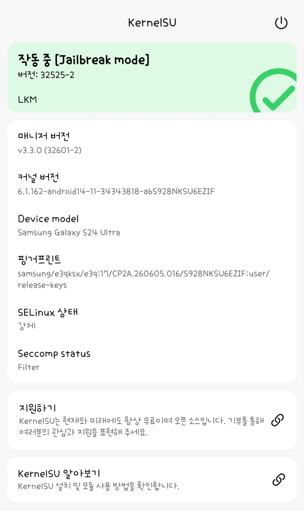

# Root My Galaxy payload · SM-S928N / S928NKSU6EZIF

Device-specific CVE-2026-43499 app payload for the Galaxy S24 Ultra `SM-S928N`, Korean
sales code `KOO` (OMC group `OKR`), firmware `S928NKSU6EZIF`, Android 17.

> [!CAUTION]
> ## ⚠️ USE AT YOUR OWN RISK
>
> This is a kernel exploit. A failed attempt can panic the kernel and reboot the phone.
> Nothing here is signed, supported, or guaranteed. **You accept the risk.**
>
> ## 🔁 IF IT REBOOTS
>
> **Do a full power-off → power-on (NOT a restart), and/or turn on airplane mode before
> the next run.**

## Run recipe

The exploit is a race. Whether it wins depends on what the phone is doing, so *when* you
run it matters more than anything in the profile:

> **Reboot → wait 2–5 minutes → run.**

Every success on this device landed in that window. Both ends of the range failed:

| Phone state at launch | Result |
| :--- | :--- |
| < 2 minutes after boot | failed (boot-time allocation churn) |
| **2–30 minutes after boot** | **all four successes** |
| ~10 hours uptime | failed (fragmented) |

If the first attempt fails, the payload keeps trying — up to 24 attempts, each at a
different delay. If the phone reboots instead, see the box above.

## Target identity

| Property | Value |
| :--- | :--- |
| Model / sales code | SM-S928N / `KOO` (bootloader stamp `KTC`, OMC group `OKR`) |
| Firmware PDA / CSC | `S928NKSU6EZIF` / `S928NOKR6EZIF` |
| Fingerprint | `samsung/e3qksx/e3q:17/CP2A.260605.016/S928NKSU6EZIF:user/release-keys` |
| Display build | `CP2A.260605.016.S928NKSU6EZIF` |
| Android release / SDK | 17 / 37 |
| Kernel release | `6.1.162-android14-11-34343818-abS928NKSU6EZIF` |
| KMI | `android14-6.1`, AArch64, `_text = 0xffffffc008000000` |
| Security patch | 2026-09-05 |

The payload refuses to run on anything else. Model, build ID, fingerprint, kernel release,
Android release, SDK and security patch are all checked before the first attempt, and the
feed re-checks them before it downloads anything. Do not relax those fields to widen
compatibility — a profile that loads on the wrong firmware writes to the wrong addresses.

## Validation

**Root was obtained on this handset four times.**

| Payload | Succeeded on | Phone state |
| :--- | :--- | :--- |
| v1.0 | attempt 5 / 24 | ~10 min uptime |
| v1.0 | attempt 4 / 24 | ~30 min uptime |
| v1.1 | attempt **1** / 24 | ~15 min uptime |
| v1.2 | attempt **1** / 24 | ~5 min uptime |

Every run reported `done=1 root=1 read_ok=1 write_ok=1 rw64=1/1 uid=2000->0`, then
completed KernelSU late-load, control-channel verification and activation. SELinux stayed
enforcing throughout. A privileged change that is impossible without root — an OMC/CSC
switch — was performed inside the first root window and survived the reboot, which is
independent confirmation that the root was usable rather than merely reported.

Root does not survive a reboot. The module is late-loaded, so a reboot returns the phone
to stock and the payload has to be run again.

Four successes are not a stability claim. Between them this device also panicked a dozen
times; see **Known failure modes**.

<p align="center">
  
</p>

<p align="center">
  <sub>KernelSU Manager after a successful run — <code>Working</code>, <code>LKM</code>,
  Jailbreak mode, SELinux <b>enforcing</b>. Note the driver reads <code>32525-2</code>
  against a <code>32601-2</code> manager: that pairing mismatch is expected, see
  <a href="#kernelsu">KernelSU</a>.</sub>
</p>

## Install

`app/RootMyGalaxy-EZIF-v1.2-debug.apk` is the app that runs the payload. It is a **debug
build**, signed with a local debug key — Android will treat it as untrusted, and an update
over a differently-signed copy will be refused.

| File | Size | SHA-256 |
| :--- | ---: | :--- |
| `app/RootMyGalaxy-EZIF-v1.2-debug.apk` | 68,898,422 | `2c0251322b1b1925f6a35b1c9b6b3dc1c1eac433141509ab976e88702ef89c21` |

```sh
adb install -r app/RootMyGalaxy-EZIF-v1.2-debug.apk
```

The profile is bundled in the APK, so it works offline. `support/targets-v3.json` is for
adding this repository as a payload source instead.

## What made this profile work

Three changes account for the difference between "never once landed the write" and the
runs above. All three are small, and two of them were wrong values rather than missing
features.

**1. `APP_P0_RETRY_AFTER_WRITER = 1`** — the one that matters most.

The shared default stops the supervisor once a child has run the stack writer, on the
grounds that a later attempt cannot be trusted. On this target the physrw pipe page is a
lottery the kernel wins about one time in three, so the first attempt that reaches the page
and finds it poisoned ends the run. With the refusal in place, `attempts=24` means
`attempts=1` and the success rate is structurally zero. The first two successes needed five
and four attempts.

**2. `P0_PHYS_OFFSET = 0x816e0000`** — measured, not inherited.

This is `memstart_addr`, not "DRAM base". `p0_data_alias()` and its inverse compute
`__pa()`/`__va()` from it, so a wrong value silently sends every computed alias to an
unrelated page. `/proc/zoneinfo` reports `zone Normal start_pfn: 530144` = `0x816e0000`,
read identically before and after a reboot, so the value is stable and readable without
root:

```
$ cat /proc/zoneinfo
Node 0, zone   Normal
  start_pfn:           530144      # × 4096 = 0x816e0000
Node 0, zone    DMA32
        present  0                 # there is no DMA32 zone on this kernel
```

The earlier `0x80000000` came from `reserved-memory/gunyah_hyp_region@80000000` in the
vendor DTB. That region is a reserved hypervisor carveout *below* the first RAM page, not
where RAM starts, and using it put every alias 23 MiB off.

**3. Nothing else.** An earlier iteration of this port carried a fifth bank slot acting as a
"production" FOPS slot, a controlled `mm_struct` group reclaim, a separate fixed-physical
data-alias verification pass, a fresh-P0-session guard and extra pselect state guards — 53
flags that no device-validated profile uses. That configuration never landed the write
once, produced an unstable P0 gate (`result=1`, `-1`, `0` on three consecutive runs) and
panicked intermittently inside the controlled reclaim. The published profile turns all of it
off and runs the shared upstream route: legacy reclaim, four bank slots, tracefs slide with
canonical FOPS addressing.

## Known failure modes

Two panic signatures were captured from `/data/log/dumpstate_lastkmsg_*_KP.log.gz`. Both are
worth knowing, because one of them explains why a *failed* attempt can take the whole boot
down.

**Torn waiter pointer** — `rt_mutex_adjust_prio_chain` → `_raw_spin_trylock`:

```
Unable to handle kernel paging request at virtual address 0000000642483c00
x24: 0000000642483c00      ← dereferenced
x27: ffffff8042483c20      ← the correct pointer, same object
```

The low 32 bits match the fake lock exactly and only the high half is wrong: the race read
the pointer while it was half written. Timing, not geometry.

**Dangling `misc_fops`** — `misc_open`, in an unrelated process:

```
pc : misc_open+0x130/0x18c        # LDR x8, [x24, #0x70]  → fops->open
x24: ffffff803bb71180             # our fake fops table
x8 : 01311f8d01311ead             # garbage
Comm: gle.android.gms             # not the exploit
```

This is the important one. A failed verify used to leave `misc_fops` pointing into a page
that dies with the attempt's process, so the next `/dev/ashmem` open *anywhere on the phone*
followed a dangling pointer and panicked. `/dev/ashmem` is opened constantly by ordinary
apps, which is why a busy phone died on attempt 1–3 while an idle one survived to 15.

`configfs_write_once()` cannot undo it, because it travels through the very table that is
broken — which is why the shared code only restores after it has proved the table works.
v1.2 adds a second bank slot whose baked-in value is the original `ashmem_fops` and fires the
same `rb_erase` write to put it back, so a failed attempt cleans up after itself.

> [!NOTE]
> That restore path has **not** been exercised yet: both v1.1 and v1.2 succeeded on the
> first attempt, so the `triggered && !verified` branch never ran. It is insurance, not a
> tested feature.

## KernelSU

| Flavour | Version | Version code | Daemon |
| :--- | :--- | :--- | :--- |
| KernelSU | 3.2.5 | `32525` | `kernelsu/ksud-e3q-S928NKSU6EZIF-kdp` |

The module and the manager APK are a pair: the module verifies the manager's signing block,
and KernelSU #3613/#3628 changed how that block is parsed. Install the **3.2.5** manager,
`KernelSU_v3.2.5_32525-release.apk`. A newer manager against this module reports a driver
version mismatch — that is the symptom, not a bug in the module.

A 3.3.0 pair has not been built for this kernel. The symbol 3.3.0 additionally imports,
`tracepoint_probe_register_prio`, is present here at `ffffffc0081de9fc` as a global text
symbol, so the upgrade is not blocked on symbol availability.

## Checksums

| File | SHA-256 |
| :--- | :--- |
| `artifacts/e3q-S928NKSU6EZIF/cve-2026-43499-app.so` | `787762ec72f98a1c0fa9f1bda98abc0b97008cf261579d39ae35a7f623a9f5c1` |
| `kernelsu/ksud-e3q-S928NKSU6EZIF-kdp` | `248725370336cd1557503a6ba525e34969b9b922bedc63f43290efc349d7b874` |
| `app/RootMyGalaxy-EZIF-v1.2-debug.apk` | `2c0251322b1b1925f6a35b1c9b6b3dc1c1eac433141509ab976e88702ef89c21` |

## Values that remain unverified

- `P0_KERNEL_PHYS_LOAD = 0xa8000000` is a same-family candidate, not a measurement. This
  Qualcomm BL archive carries ABL/UEFI rather than the `sboot.bin` the upstream porting
  guide disassembles. The LinuxLoader PE does yield the selector — `min EFI RAM descriptor
  base + 0x80000`, ARM64 `text_offset = 0`, region `0x05600000` — but the runtime descriptor
  base is not readable from an unprivileged shell, so the formula cannot be closed offline.
  Two constraints narrow it: `0x80080000` sits below the first RAM page and inside the
  gunyah carveout, and the reserved-memory map leaves no 86 MiB gap directly above the first
  RAM page, while `0xa8000000` falls in the free span between `0x9df00000` and `0xff800000`.
- `SKB_DATA_DELTA` and the bank geometry are inherited from the device-validated
  `e3q-S928BXXS6DZF2` profile, whose struct offsets this kernel matches exactly
  (`pi_waiters 0x938`, `pi_tree_entry 0x18`, `pi_lock 0x924`, `pi_blocked_on 0x950`).
- The per-attempt delay sweep (20–75 ms, v1.1) has not been shown to matter: both runs since
  it was added succeeded at 50 ms on attempt 1, which is where the old pin already was.

## Contents

```
app/                           installer APK (debug build)
artifacts/e3q-S928NKSU6EZIF/   exploit payload and its checksum record
kernelsu/                      paired KernelSU daemon
src/targets/e3q-S928NKSU6EZIF/ target profile, layout header, P0 fingerprint
support/targets-v3.json        schema-v3 payload feed entry
docs/ports/e3q-S928NKSU6EZIF/  port report: what was measured, what was not
```

## Licence and scope

The payload sources this profile builds against are BuSung's
[Root-My-Galaxy-Payloads](https://github.com/BuSung-dev/Root-My-Galaxy-Payloads) (Apache
2.0). Only the target profile, the built artifact and the records under `docs/` are specific
to this repository.

Do not reuse the target offsets, fingerprint values, exploit binary or KernelSU daemon on
another device or firmware. A different device needs its own firmware extraction, symbol and
offset audit, target profile, payload build, KernelSU pairing and on-device validation.

Use only on a device you own or are authorised to test. The payload does not flash firmware
and does not touch partitions, CSC or user data.
